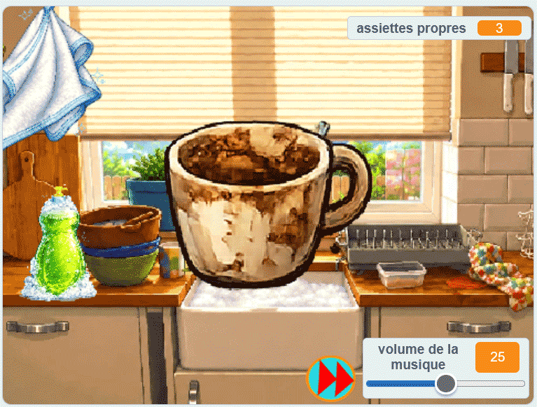

## Ce que tu vas faire

Tu vas créer un **simulateur de lave-vaisselle**. Le joueur ou la joueuse ajoute du savon, frotte une assiette sale jusqu’à ce qu’elle brille, puis la fait glisser dans l’égouttoir avant que l’assiette sale suivante n’apparaisse.

