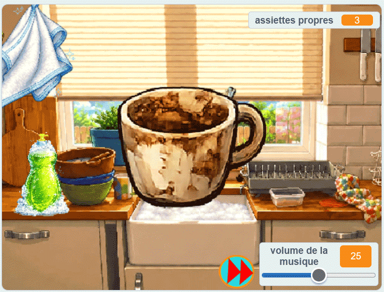

## Ce que tu vas faire

Tu vas créer un simulateur de **lave-vaisselle chaleureux et relaxant**. Le joueur ou la joueuse ajoute du savon, frotte une assiette sale jusqu’à ce qu’elle brille, puis la fait glisser dans l’égouttoir avant que l’assiette sale suivante n’apparaisse.

> [!TIP]
>
> Un **jeu cosy** est conçu pour offrir une expérience calme, accueillante et satisfaisante, plutôt que stressante ou compétitive.

> [!NOPRINT]
>
> 

>  <iframe allowtransparency="true" width="485" height="402" src="https://scratch.mit.edu/projects/embed/1362381726/?autostart=false" frameborder="0"></iframe>
> 

> [!PRINTONLY]
>
> 

Tu commenceras par un projet Scratch qui a déjà les sprites, costumes et sons. Tu créeras des variables et une liste au fur et à mesure que tu écris le code.

### Voici ce dont tu auras besoin  :

- L'éditeur Scratch
- Le [projet de démarrage du simulateur de lave-vaisselle](https://scratch.mit.edu/projects/1362382639/editor){:target="_blank"}
