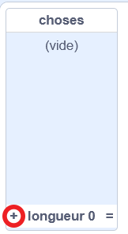
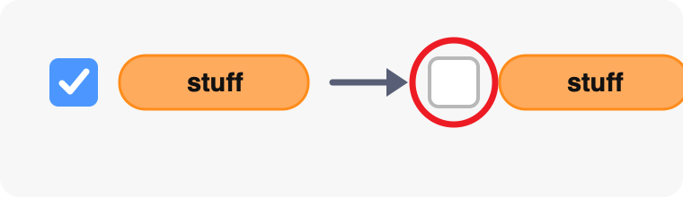
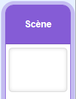
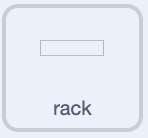
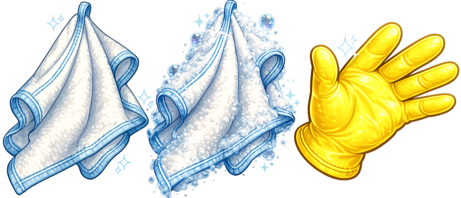

## Lancer le lave-vaisselle

Configure l'état du jeu, place le rack et fais en sorte que la serviette suive le pointeur de la souris.

> [!TASK]
>
> Ouvre [Démarrage Lave-vaisselle](https://scratch.mit.edu/projects/1362382639/editor){:target="_blank"}. Il contient déjà les sprites, les costumes et les sons dont tu as besoin.

> [!TASK]
>
> Ouvre le menu des blocs `Variables`{:class="block3variables"}. Crée ces variables pour **tous les sprites** :
>
> - `assiettes propres`{:class="block3variables"} : ceci stocke le score du joueur ou de la joueuse. Laisse cette variable cochée pour qu'elle apparaisse sur la scène.
> - `propre`{:class="block3variables"} : ceci stocke une valeur booléenne indiquant si l'assiette actuelle est propre. **Décoche cette variable.**
> - `savon`{:class="block3variables"} : stocke une valeur booléenne qui dit si le joueur ou la joueuse a récupéré du savon. **Décoche cette variable.**
>
> Assure-toi que la seule variable encore cochée est `assiettes propres`{:class="block3variables"} :
>
> <p align="center"></p>

> [!TASK]
>
> Garde la scène sélectionnée. Choisi **Créer une liste** dans le menu des blocs `Variables`{:class="block3variables"} et crée une liste appelée `choses`{:class="block3variables"} **pour tous les sprites**.
>
> Ajoute `bol` comme premier élément de la liste. Tu ajouteras les autres éléments de vaisselle plus tard.
>
> 
>
> Décoche la case à côté de `choses`{:class="block3variables"} pour que la liste n'apparaisse pas sur la scène.
>
> 

> [!TASK]
>
> Ajoute le script ci-dessous à la scène pour réinitialiser le jeu. Dans ce projet, les variables `propre`{:class="block3variables"} et `savon`{:class="block3variables"} ne stockent que `true` ou `false`, initialise donc les deux avec la valeur booléenne `false`.
>
> Dans le menu du bloc `envoyer à tous ()`{:class="block3events"}, choisis **Nouveau message**. Nomme-le `bol`.
>
> 
>
> ```blocks3
> +when green flag clicked
> +set [clean plates v] to (0)
> +set [clean v] to [false]
> +set [soap v] to [false]
> +broadcast (bowl v)
> ```

> [!TIP]
>
> Initialiser une variable signifie lui attribuer une valeur de départ. Ici, le jeu commence avec un score de `0`, et `propre` et `savon` sont définis sur `false`.

> [!TASK]
>
> Remplace `bol` dans le bloc `envoyer à tous ()`{:class="block3events"} par des blocs qui sélectionnent un élément aléatoire parmi `choses`{:class="block3variables"}.
>
> Pour l'instant, la liste ne contient qu'un seul élément ; ce script diffusera donc toujours `bol`. Lorsque tu ajouteras d'autres éléments ultérieurement, le même code choisira parmi eux.
>
> 
>
> ```blocks3
> when green flag clicked
> set [clean plates v] to (0)
> set [clean v] to [false]
> set [soap v] to [false]
> +broadcast (item (pick random (1) to (length of [stuff v])) of [stuff v])
> ```

> [!TASK]
>
> Sélectionne le sprite `rack` dans le panneau Sprite. Ce sera la cible pour les assiettes propres. Utilise un bloc `quand le drapeau vert est cliqué`{:class="block3events"} pour le placer au bon endroit.
>
> Le sprite `rack` est simplement une boîte de collision. Il semble clair parce que le rack de séchage que le joueur ou la joueuse voit est déjà dessiné sur l'arrière-plan.
>
> 
>
> ```blocks3
> +when green flag clicked
> +go to x: (140) y: (-38)
> ```

> [!TIP]
>
> Dans les jeux, deux sprites **entrent en collision** lorsqu'ils se touchent. Plus tard, un bloc `touche le () ?`{:class="block3sensing"} détectera lorsqu'une assiette propre entre en collision avec le rack.

> [!TASK]
>
> Sélectionne le sprite `serviette` dans le panneau Sprite. Ajoute ce script pour que la serviette suive le pointeur de la souris et reste devant les autres sprites.
>
> 
>
> ```blocks3
> +when green flag clicked
> +forever
> +go to (mouse-pointer v)
> +go to [front v] layer
> end
> ```

> [!TASK]
>
> <p align="center"></p>
>
> Clique sur le drapeau vert, puis déplace le pointeur de la souris sur la scène. La serviette devrait le suivre.
