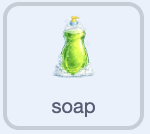
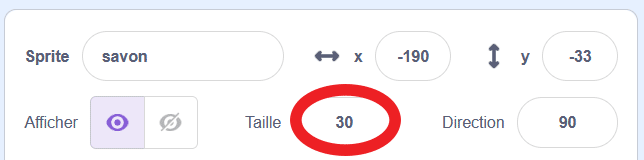

## Ajouter un savon et une serviette

Rends le savon cliquable et fais en sorte que la serviette change pour indiquer l'état du jeu.

> [!TASK]
>
> Sélectionne le sprite `savon` dans le panneau Sprite. Ajoute du code permettant au joueur ou à la joueuse d'utiliser le savon avant de laver la vaisselle.
>
> 
>
> ```blocks3
> +when this sprite clicked
> +start sound (Bubbles v)
> +set [soap v] to [true]
> ```

> [!TASK]
>
> Ajoute un autre script au sprite `savon` pour qu'il se place derrière la vaisselle.
>
> 
>
> ```blocks3
> +when green flag clicked
> +set drag mode [not draggable v]
> +go to [back v] layer
> ```

> [!NOTE]
>
> `mettre mode de glissement à [non glissable]` empêche uniquement le glissement en mode plein écran. Pendant tes tests dans l'éditeur, tu peux toujours faire glisser le savon et les autres sprites.

> [!TASK]
>
> Démarre un autre script sur le sprite `savon`. Définis sa taille à `30` pour cent avant d'ajouter des blocs qui modifient sa taille. Cette taille initiale connue facilite la remise à zéro du savon en cas d'erreur.
>
> Ajoute une boucle `répéter indéfiniment`{:class="block3control"} sous le bloc de taille.
>
> 
>
> ```blocks3
> +when green flag clicked
> +set size to (30) %
> +forever
> end
> ```

> [!TIP]
>
> `30` pour cent est la taille de départ prédéfinie pour le savon. Tu peux faire des essais en modifiant la valeur dans le bloc `mettre la taille à () % de la taille initiale`{:class="block3looks"}, et la remettre à `30` si tu veux la réinitialiser.
>
> 

> [!TASK]
>
> À l'intérieur de la boucle `répéter indéfiniment`{:class="block3control"}, ajoute une boucle `répéter ()`{:class="block3control"} qui agrandit progressivement le savon.
>
> 
>
> ```blocks3
> when green flag clicked
> set size to (30) %
> forever
> +repeat (15)
> +change size by (0.2)
> end
> end
> ```

> [!TIP]
>
> Pour gagner du temps, clique avec le bouton droit sur le bloc supérieur d'un groupe et choisis **Dupliquer** pour copier le groupe entier. Essaie ceci avec les blocs `répéter ()` et `ajouter () à la taille`, ou avec un bloc `si () alors sinon` qui contient déjà son opérateur et sa variable. Puis ne change que ce qui doit être différent.

> [!TASK]
>
> Sous la première boucle `répéter ()`{:class="block3control"}, ajoute une autre boucle qui ramène le savon à `30` pour cent.
>
> Ensemble, les deux boucles font grossir et rétrécir doucement le savon. Cela attire l'attention du joueur ou de la joueuse et lui indique clairement qu'il ou elle peut interagir avec le savon.
>
> 
>
> ```blocks3
> when green flag clicked
> set size to (30) %
> forever
> repeat (15)
> change size by (0.2)
> end
> +repeat (15)
> +change size by (-0.2)
> end
> end
> ```

> [!TASK]
>
> Sélectionne le sprite `serviette` dans le panneau Sprite. Ajoute un autre script qui commence par afficher la serviette sèche.
>
> 
>
> ```blocks3
> +when green flag clicked
> +forever
> +switch costume to (cloth1 v)
> end
> ```

> [!TASK]
>
> Remplace le bloc `basculer sur le costume (serviette1 v)`{:class="block3looks"} par un bloc `si () alors sinon`{:class="block3control"}. Garde la serviette sèche dans la partie `sinon`{:class="block3control"}.
>
> 
>
> ```blocks3
> when green flag clicked
> forever
> +if <(clean) = [true]> then
> else
> switch costume to (cloth1 v)
> end
> end
> ```

> [!TASK]
>
> Ajoute un bloc `basculer sur le costume ()`{:class="block3looks"} à l'intérieur de la première partie pour afficher la main lorsque l'assiette est propre.
>
> 
>
> ```blocks3
> when green flag clicked
> forever
> if <(clean) = [true]> then
> +switch costume to (hand v)
> else
> switch costume to (cloth1 v)
> end
> end
> ```

> [!TASK]
>
> À l'intérieur du bloc `sinon`{:class="block3control"}, ajoute un autre bloc `si () alors sinon`{:class="block3control"}`pour vérifier si le joueur ou la joueuse a ramassé du savon. Garde la serviette sèche dans la nouvelle partie`sinon\`{:class="block3control"}.
>
> 
>
> ```blocks3
> when green flag clicked
> forever
> if <(clean) = [true]> then
> switch costume to (hand v)
> else
> +if <(soap) = [true]> then
> else
> switch costume to (cloth1 v)
> end
> end
> end
> ```

> [!TASK]
>
> Ajoute un bloc `basculer sur le costume ()`{:class="block3looks"} dans la partie du savon pour montrer la serviette pleine de savon.
>
> 
>
> ```blocks3
> when green flag clicked
> forever
> if <(clean) = [true]> then
> switch costume to (hand v)
> else
> if <(soap) = [true]> then
> +switch costume to (cloth2 v)
> else
> switch costume to (cloth1 v)
> end
> end
> end
> ```

> [!TASK]
>
> <p align="center"></p>
>
> Clique sur le drapeau vert, puis clique sur le savon sur la scène. Le savon doit pulser doucement, et la serviette doit prendre son costume savonneux.

> [!TIP]
>
> **Le retour visuel** indique au joueur ou la joueuse qu'une action a fonctionné. Changer le costume serviette permet de voir clairement quand le joueur ou la joueuse a ramassé du savon.
