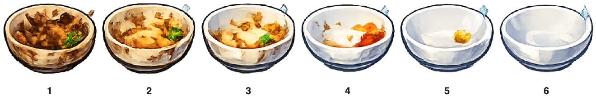
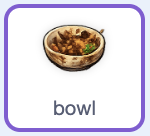

## Faire apparaître un élément de vaisselle

Commence par coder le `bol`. Plus tard, tu copieras ses scripts sur les autres sprites de vaisselle.

Le projet de démarrage nomme ce sprite `bol` et ses costumes `1` à `6`. Le costume `1` représente le bol sale, et le costume `6` représente le bol d'une propreté éclatante.



> [!TASK]
>
> Sélectionne le sprite `bol` dans le panneau Sprite. Ajoute un bloc `quand le drapeau vert est cliqué`{:class="block3events"} avec un bloc `cacher`{:class="block3looks"}.
>
> 
>
> ```blocks3
> +when green flag clicked
> +hide
> ```

> [!TASK]
>
> Démarre un autre script sur le sprite `bol` avec un bloc `quand je reçois ()`{:class="block3events"}. Choisis le message `bol` que tu as créée précédemment.
>
> Change le sprite pour le costume numéro `1` afin que le bol sale apparaisse dans l'évier.
>
> 
>
> ```blocks3
> +when I receive (bowl v)
> +switch costume to (1)
> +set [clean v] to [false]
> +set size to (0) %
> +go to x: (0) y: (-120)
> +show
> +set drag mode [not draggable v]
> ```

> [!TASK]
>
> Ajoute une boucle au même script pour que le bol remonte hors de l'évier.
>
> 
>
> ```blocks3
> when I receive (bowl v)
> switch costume to (1)
> set [clean v] to [false]
> set size to (0) %
> go to x: (0) y: (-120)
> show
> set drag mode [not draggable v]
> +repeat (20)
> +change y by (6)
> +change size by (6)
> end
> ```

> [!TASK]
>
> Ajoute des blocs au bas du même script pour attendre que le bol soit propre. Dans le bloc `envoyer à tous ()`{:class="block3events"}, choisis **Nouveau message** et crée un message appelé `propre`.
>
> 
>
> ```blocks3
> when I receive (bowl v)
> switch costume to (1)
> set [clean v] to [false]
> set size to (0) %
> go to x: (0) y: (-120)
> show
> set drag mode [not draggable v]
> repeat (20)
> change y by (6)
> change size by (6)
> end
> +wait until <(clean) = [true]>
> +broadcast (clean v)
> ```

> [!TASK]
>
> 
>
> Clique sur le drapeau vert. Le bol sale devrait apparaître au milieu de l'évier.

> [!TIP]
>
> Le bol commence minuscule et grandit à mesure qu'il sort de l'évier.
