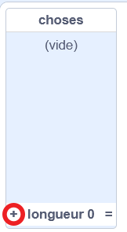
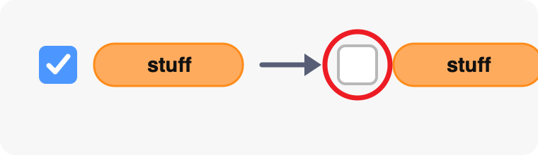
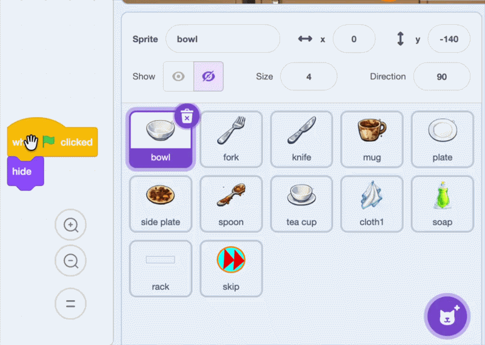

## Ajoutez les autres éléments de vaisselle

Ajoute chaque élément de vaisselle à la sélection aléatoire, puis copie les scripts du bol une fois terminés sur les autres sprites de vaisselle.

> [!TIP]
>
> Les développeurs de jeux conçoivent et testent souvent d'abord un **prototype** fonctionnel. Corriger le bol avant de copier ses scripts facilite la recherche des problèmes.

> [!TASK]
>
> Sélectionne la scène et ouvre le menu des blocs `Variables`{:class="block3variables"}. Coche la case à côté de `choses`{:class="block3variables"} pour que tu puisses voir la liste sur la scène.
>
> 
>
> Utilise le bouton plus de la liste pour ajouter ces sept noms de messages, un élément par ligne :
>
> 2. `fourchette`
> 3. `couteau`
> 4. `mug`
> 5. `assiette`
> 6. `petite assiette`
> 7. `cuillère`
> 8. `tasse`
>
> 
>
> Décoche à nouveau la case à côté de `choses`{:class="block3variables"} pour que la liste n'apparaisse pas sur la scène.
>
> 

> [!TASK]
>
> Fais glisser chacun des quatre scripts du bol sur tous les autres sprites de vaisselle dans le panneau des sprites :
>
> - `fourchette`
> - `couteau`
> - `mug`
> - `assiette`
> - `petite assiette`
> - `cuillère`
> - `tasse`
>
> 

> [!TASK]
>
> Sélectionne chaque sprite copié dans le panneau des sprites. Dans le script qui fait apparaître la vaisselle sale, change `quand je reçois (bol)`{:class="block3events"} par un message portant le même nom que le sprite. Choisis **Nouveau message** pour créer chaque message la première fois que tu en a besoin.
>
> 
>
> Laisse le premier bloc `basculer sur le costume ()`{:class="block3looks"} défini sur le numéro de costume `1`. Le costume `1` correspond au costume très sale de chaque sprite de vaisselle, donc ce bloc est identique dans chaque script copié.

> [!TASK]
>
> Clique sur le drapeau vert et joue plusieurs manches. Vérifie que différents éléments de vaisselle sale apparaissent et que chaque élément commence avec le costume `1`, peut être frotté pour être nettoyé et augmente le score lorsqu’il est placé sur le rack.
>
> 

> [!TIP]
>
> La diffusion aléatoire utilise `longueur de [choses]`{:class="block3variables"}, elle peut donc choisir parmi les huit éléments de la liste sans que tu as à modifier la plage de nombres aléatoires.
