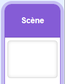
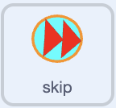
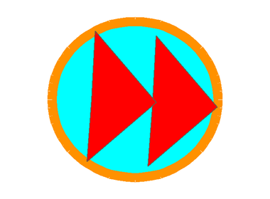

## Ajouter des commandes pour contrôler la musique

Ajoute une musique d'ambiance, un curseur de volume et un bouton permettant de passer à la chanson suivante.

### Jouer de la musique

> [!TASK]
>
> Sélectionne la scène, puis définis ces variables **pour tous les sprites** à partir du menu des blocs `Variables`{:class="block3variables"} :
>
> - `chanson`{:class="block3variables"} : ceci stocke la chanson en cours de lecture. **Décoche cette variable.**
> - `volume de la musique`{:class="block3variables"} : ceci stocke le volume sonore de la musique. Laisse cette variable cochée pour qu'elle apparaisse sur la scène.
>
> <p align="center"></p>

> [!TASK]
>
> Garde la scène sélectionnée. Ajoute les blocs de configuration de la musique au début du script `quand le drapeau vert est cliqué`{:class="block3events"}, avant l'envoi du message qui sélectionne un élément de vaisselle au hasard.
>
> Dans le bloc `envoyer à tous ()`{:class="block3events"}, choisis **Nouveau message** et crée un message appelé `jouer musique`.
>
> 
>
> ```blocks3
> when green flag clicked
> set [clean plates v] to (0)
> set [clean v] to [false]
> set [soap v] to [false]
> +set [song v] to (pick random (1) to (3))
> +set [music volume v] to (25)
> +broadcast (play music v)
> broadcast (item (pick random (1) to (length of [stuff v])) of [stuff v])
> ```

> [!TASK]
>
> Démarre un autre script sur la scène avec un bloc `quand je reçois ()`{:class="block3events"}, et choisis le message `jouer musique`. Ajoute une boucle vide \`répéter indéfiniment'{:class="block3control"}.
>
> 
>
> ```blocks3
> +when I receive (play music v)
> +forever
> end
> ```

> [!TASK]
>
> Au début de la boucle `répéter indéfiniment`{:class="block3control"}, vérifie si le numéro de la chanson est supérieur à `3`. Si c'est le cas, réinitialise `chanson`{:class="block3variables"} à `1` afin que la musique redémarre à partir de la première chanson.
>
> 
>
> ```blocks3
> when I receive (play music v)
> forever
> +if <(song) > (3)> then
> +set [song v] to (1)
> end
> end
> ```

> [!TIP]
>
> Un **contrôle de dépassement** recherche un nombre qui a dépassé la dernière option et le renvoie au début. Ici, un numéro de chanson supérieur à `3` passe à `1`.

> [!TASK]
>
> Sous cette vérification, ajoute un bloc `si () alors sinon`{:class="block3control"}. Vérifie si `chanson`{:class="block3variables"} est `1`. Laisse les deux parties vides pour le moment.
>
> 
>
> ```blocks3
> when I receive (play music v)
> forever
> if <(song) > (3)> then
> set [song v] to (1)
> end
> +if <(song) = (1)> then
> else
> end
> end
> ```

> [!TASK]
>
> Dans la première partie, ajoute un bloc qui joue `chanson1` jusqu'à ce qu'elle soit terminée.
>
> 
>
> ```blocks3
> when I receive (play music v)
> forever
> if <(song) > (3)> then
> set [song v] to (1)
> end
> if <(song) = (1)> then
> +play sound (song1 v) until done
> else
> end
> end
> ```

> [!TASK]
>
> À l'intérieur de la première partie `sinon`{:class="block3control"}, ajoute un autre bloc `si () alors sinon`{:class="block3control"}. Vérifie si `chanson`{:class="block3variables"} est `2`. Laisse les deux nouvelles parties vides pour le moment.
>
> 
>
> ```blocks3
> when I receive (play music v)
> forever
> if <(song) > (3)> then
> set [song v] to (1)
> end
> if <(song) = (1)> then
> play sound (song1 v) until done
> else
> +if <(song) = (2)> then
> else
> end
> end
> end
> ```

> [!TASK]
>
> Dans la partie `chanson = 2`, ajoute un bloc qui joue `chanson2` jusqu'à ce qu'elle se termine.
>
> 
>
> ```blocks3
> when I receive (play music v)
> forever
> if <(song) > (3)> then
> set [song v] to (1)
> end
> if <(song) = (1)> then
> play sound (song1 v) until done
> else
> if <(song) = (2)> then
> +play sound (song2 v) until done
> else
> end
> end
> end
> ```

> [!TASK]
>
> Dans la dernière partie `sinon`{:class="block3control"}, ajoute un bloc qui joue `chanson3` jusqu'à ce qu'elle se termine.
>
> 
>
> ```blocks3
> when I receive (play music v)
> forever
> if <(song) > (3)> then
> set [song v] to (1)
> end
> if <(song) = (1)> then
> play sound (song1 v) until done
> else
> if <(song) = (2)> then
> play sound (song2 v) until done
> else
> +play sound (song3 v) until done
> end
> end
> end
> ```

> [!TASK]
>
> En bas de la boucle `répéter indéfiniment`{:class="block3control"}, ajoute un bloc `ajouter () à ()`{:class="block3variables"}. Cela passe automatiquement à la chanson suivante lorsqu’une chanson est terminée.
>
> 
>
> ```blocks3
> when I receive (play music v)
> forever
> if <(song) > (3)> then
> set [song v] to (1)
> end
> if <(song) = (1)> then
> play sound (song1 v) until done
> else
> if <(song) = (2)> then
> play sound (song2 v) until done
> else
> play sound (song3 v) until done
> end
> end
> +change [song v] by (1)
> end
> ```

### Contrôler la musique

> [!TASK]
>
> Sur la scène, double-clique sur l'affichage de la variable `volume de la musique`{:class="block3variables"} jusqu'à ce qu'il se transforme en curseur, puis déplace-le dans le coin inférieur de la scène. Le joueur ou la joueuse pourra faire glisser le curseur pour modifier le volume de la musique.
>
> <p align="center"></p>

> [!TASK]
>
> Garde la scène sélectionnée. Ajoute un autre script pour que son volume sonore suive le curseur `volume de la musique`{:class="block3variables"} pendant que le jeu fonctionne.
>
> 
>
> ```blocks3
> +when green flag clicked
> +forever
> +set volume to (music volume) %
> end
> ```

> [!TIP]
>
> L'équilibrage du volume de la musique et des effets sonores s'appelle le **mixage audio**. Une musique plus douce laisse davantage de place aux sons du nettoyage et du marquage du score.

> [!TASK]
>
> Sélectionne le sprite `passer` dans le panneau Sprite. Ajoute un script qui empêche le joueur de faire glisser le bouton.
>
> 
>
> ```blocks3
> +when green flag clicked
> +set drag mode [not draggable v]
> ```

> [!TASK]
>
> Garde le sprite `passer` sélectionné. Ajoute un autre script qui diffuse le message `passer` lorsque le joueur ou la joueuse clique sur le bouton sur la scène.
>
> 
>
> ```blocks3
> +when this sprite clicked
> +broadcast (skip v)
> ```

> [!TASK]
>
> Sélectionne la scène. Ajoute un script pour le message `passer` qui arrête la chanson en cours.
>
> 
>
> ```blocks3
> +when I receive (skip v)
> +stop all sounds
> ```
>
> L'arrêt du son permet à la boucle musicale de continuer jusqu'à son bloc `ajouter 1 à chanson`{:class="block3variables"}. Le script de contrôle du volume continue de fonctionner, et la vérification au début de la boucle musicale réinitialise tout numéro de chanson supérieur à `3`.

> [!TASK]
>
> Clique sur le drapeau vert et lave quelques éléments de vaisselle. Fais glisser le curseur du volume et vérifie que la musique devient plus ou moins forte. Clique sur le bouton « passer » sur la scène et vérifie que la chanson change.
>
> <p align="center"></p>

> [!SAVE]
