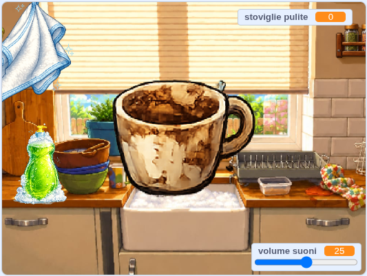

## Che cosa farai

Costruirai un **accogliente simulatore di lavastoviglie**. Il giocatore aggiunge il sapone, strofina un piatto sporco finché non brilla, poi lo trascina nello scolapiatti prima che compaia il piatto sporco successivo.

