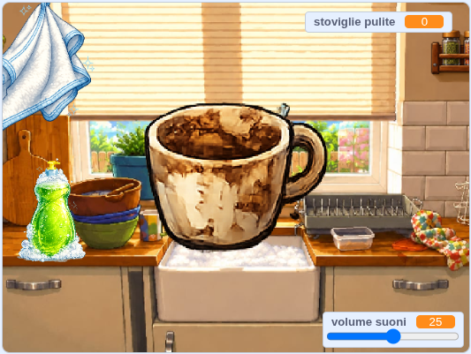

## Che cosa farai

Costruirai un **accogliente simulatore di lavastoviglie**. Il giocatore aggiunge il sapone, strofina un piatto sporco finché non brilla, poi lo trascina nello scolapiatti prima che compaia il piatto sporco successivo.

> [!TIP]
>
> Un **gioco accogliente** è progettato per trasmettere una sensazione di calma, accoglienza e soddisfazione, piuttosto che di stress o competizione.

> [!NOPRINT]
>
> 

>  <iframe allowtransparency="true" width="485" height="402" src="https://scratch.mit.edu/projects/embed/1362381726/?autostart=false" frameborder="0"></iframe>
> 

> [!PRINTONLY]
>
> 

Inizierai con un progetto Scratch che ha già gli sprite, i costumi e i suoni. Durante la scrittura del codice, creerai delle variabili e un elenco.

### Ti serviranno:

- L'editor di Scratch
- Il progetto [Avviatore simulatore di lavastoviglie](https://scratch.mit.edu/projects/1362382639/editor){:target="_blank"}
