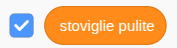
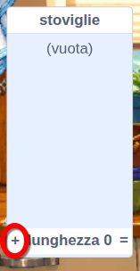
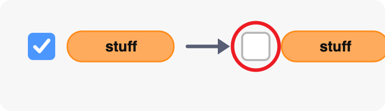
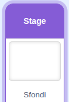
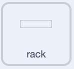
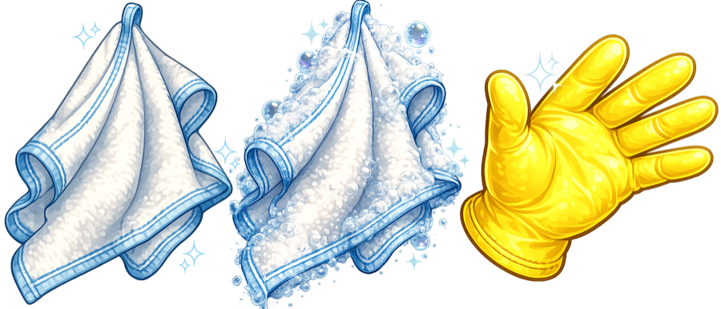

## Avviare la lavastoviglie

Imposta lo stato del gioco, posiziona il supporto e fai in modo che il tessuto segua il puntatore del mouse.

> [!TASK]
>
> Il progetto [Avviatore simulatore di lavastoviglie](https://scratch.mit.edu/projects/1362382639/editor){:target="_blank"}. Ha già gli sprite, costumi e suoni di cui hai bisogno.

> [!TASK]
>
> Apri il menu dei blocchi `Variabili`{:class="block3variables"}. Rendi queste variabili **per tutti gli sprite**:
>
> - `piatti puliti`{:class="block3variables"} — questo memorizza il punteggio del giocatore. Lascia questa variabile spuntata in modo che appaia sullo stage.
> - `puliti`{:class="block3variables"} — questo memorizza un valore booleano che dice se il piatto corrente è pulito. **Deseleziona questa variabile.**
> - `sapone`{:class="block3variables"} — questo memorizza un valore booleano che dice se il giocatore ha preso il sapone. **Deseleziona questa variabile.**
>
> Assicurati che l'unica variabile ancora selezionata sia `piatti puliti`{:class="block3variables"}:
>
> <p align="center"></p>

> [!TASK]
>
> Mantieni lo Stage selezionato. Scegli **Crea una lista** dal menu `Variabili`{:class="block3variables"} e crea una lista chiamata `stoviglie`{:class="block3variables"} **per tutti gli sprite**.
>
> Aggiungi `bowl` come primo elemento dell'elenco. Aggiungerai gli altri piatti più tardi.
>
> 
>
> Deseleziona la casella di controllo accanto a `stoviglie`{:class="block3variables"} in modo che la lista non appaia sullo Stage.
>
> 

> [!TASK]
>
> Aggiungi lo script seguente allo Stage per riavviare il gioco. In questo progetto, le variabili `puliti`{:class="block3variables"} e `sapone`{:class="block3variables"} memorizzano solo `vero` o `falso`, quindi inizializzano entrambe con il valore booleano `falso`.
>
> Dal menu nel blocco `invia a tutti ()`{:class="block3events"}, scegli **Nuovo messaggio**. Assegna al nuovo broadcast il nome `bowl`.
>
> 
>
> ```blocks3
> +when green flag clicked
> +set [clean plates v] to (0)
> +set [clean v] to [false]
> +set [soap v] to [false]
> +broadcast (bowl v)
> ```

> [!TIP]
>
> **Inizializzare** una variabile significa assegnarle un valore iniziale. Qui, il gioco inizia con un punteggio di `0` e `pulisci` e `sapone` impostati su `falso`.

> [!TASK]
>
> Sostituisci `ciotola` nel blocco `invia a tutti ()`{:class="block3events"} con blocchi che selezionano un elemento casuale da `stoviglie`{:class="block3variables"}.
>
> C'è solo un elemento nella lista per ora, quindi questo script trasmetterà sempre `ciotola`. Quando in seguito aggiungerai altri elementi, lo stesso codice sceglierà tra di essi.
>
> 
>
> ```blocks3
> when green flag clicked
> set [clean plates v] to (0)
> set [clean v] to [false]
> set [soap v] to [false]
> +broadcast (item (pick random (1) to (length of [stuff v])) of [stuff v])
> ```

> [!TASK]
>
> Seleziona lo sprite `scolapiatti` nel pannello Sprite. Sarà l'obiettivo per le stoviglie pulite. Utilizza un blocco `Quando si clicca sulla bandierina verde`{:class="block3events"} per posizionarlo correttamente.
>
> Lo sprite `scolapiatti` è semplicemente una scatola di collisione. Sembra semplice perché lo stendino che il giocatore vede è già disegnato sullo sfondo.
>
> 
>
> ```blocks3
> +when green flag clicked
> +go to x: (140) y: (-38)
> ```

> [!TIP]
>
> Nei videogiochi, due sprite **si scontrano** quando si toccano. Successivamente, un blocco `sto toccando ()?`{:class="block3sensing"} rileverà quando un piatto pulito entra in collisione con il supporto.

> [!TASK]
>
> Seleziona lo sprite `strofinaccio` nel pannello Sprite. Aggiungi questo script per far sì che il tessuto segua il puntatore del mouse e rimanga davanti agli altri sprite.
>
> 
>
> ```blocks3
> +when green flag clicked
> +forever
> +go to (mouse-pointer v)
> +go to [front v] layer
> end
> ```

> [!TASK]
>
> <p align="center"></p>
>
> Test: Clicca sulla bandierina verde e muovi il mouse sullo stage. La bacchetta dovrebbe seguirlo.
