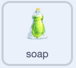
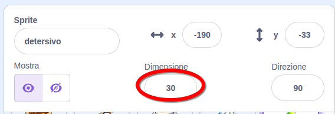
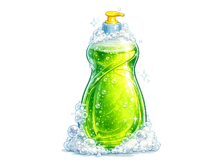

## Aggiungi sapone e un panno

Rendi il sapone cliccabile e fai in modo che il panno cambi per mostrare lo stato del gioco.

> [!TASK]
>
> Seleziona lo sprite `cloth` nel pannello Sprite. Aggiungi il codice in modo che il giocatore possa usare il sapone prima di lavare un piatto.
>
> 
>
> ```blocks3
> +when this sprite clicked
> +start sound (Bubbles v)
> +set [soap v] to [true]
> ```

> [!TASK]
>
> Aggiungi un altro script allo sprite del sapone per farlo posizionare dietro i piatti.
>
> 
>
> ```blocks3
> +when green flag clicked
> +set drag mode [not draggable v]
> +go to [back v] layer
> ```

> [!NOTE]
>
> `set drag mode [not draggable]` impedisce il trascinamento solo in modalità a schermo intero. Durante il test nell'editor, puoi ancora trascinare il sapone e altri sprite.

> [!TASK]
>
> Avvia un altro script sullo sprite `sapone`. Imposta la sua dimensione al 30% prima di aggiungere blocchi che ne modificano le dimensioni. Questa dimensione iniziale nota rende facile ripristinare la saponetta in caso di errore.
>
> Aggiungi un ciclo `per sempre`{:class="block3control"} sotto il blocco dimensioni.
>
> 
>
> ```blocks3
> +when green flag clicked
> +set size to (30) %
> +forever
> end
> ```

> [!TIP]
>
> `30` percentuale è la dimensione di partenza preimpostata per il sapone. Puoi sperimentare modificando il valore nel blocco `porta dimensione a () %`{:class="block3looks"} e riportarlo a `30` se vuoi ripristinarlo.
>
> 

> [!TASK]
>
> All'interno del ciclo `per sempre`{:class="block3control"}, aggiungi un ciclo `ripeti ()`{:class="block3control"} che gradualmente rende il sapone più grande.
>
> 
>
> ```blocks3
> when green flag clicked
> set size to (30) %
> forever
> +repeat (15)
> +change size by (0.2)
> end
> end
> ```

> [!TIP]
>
> Per risparmiare tempo, fai clic con il tasto destro del mouse sul blocco superiore di un gruppo e scegli **Duplica** per copiare l'intero gruppo. Prova con i blocchi `repeat ()` e `change size by ()`, o con un blocco `if () poi else` che contiene già il suo operatore e variabile. Quindi modifica solo ciò che deve essere diverso.

> [!TASK]
>
> Sotto il primo ciclo `ripeti ()`{:class="block3control"}, aggiungi un altro ciclo che riporta il sapone al `30` percento.
>
> Insieme, i due anelli fanno sì che il sapone si espanda e si contragga delicatamente. Questo attira l'attenzione del giocatore e chiarisce che può interagire con il sapone.
>
> 
>
> ```blocks3
> when green flag clicked
> set size to (30) %
> forever
> repeat (15)
> change size by (0.2)
> end
> +repeat (15)
> +change size by (-0.2)
> end
> end
> ```

> [!TASK]
>
> Seleziona lo sprite `cloth` nel pannello Sprite. Aggiungi un altro script che inizi mostrando il panno asciutto.
>
> 
>
> ```blocks3
> +when green flag clicked
> +forever
> +switch costume to (cloth1 v)
> end
> ```

> [!TASK]
>
> Sostituisci il `passa al costume (cloth1 v)`{:class="block3looks"} con un blocco `se () allora`{:class="block3control"}. Mantieni il panno asciutto nel ramo `altrimenti`{:class="block3control"}.
>
> 
>
> ```blocks3
> when green flag clicked
> forever
> +if <(clean) = [true]> then
> else
> switch costume to (cloth1 v)
> end
> end
> ```

> [!TASK]
>
> Aggiungi un blocco `spassa al costume ()`{:class="block3looks"} all'interno del primo ramo per mostrare la mano quando il piatto è pulito.
>
> 
>
> ```blocks3
> when green flag clicked
> forever
> if <(clean) = [true]> then
> +switch costume to (hand v)
> else
> switch costume to (cloth1 v)
> end
> end
> ```

> [!TASK]
>
> All'interno del blocco `altrimenti`{:class="block3control"}, aggiungi un altro blocco `se () allora`{:class="block3control"} per verificare se il giocatore ha preso sapone. Mantieni il panno asciutto nel ramo `altrimenti`{:class="block3control"}.
>
> 
>
> ```blocks3
> when green flag clicked
> forever
> if <(clean) = [true]> then
> switch costume to (hand v)
> else
> +if <(soap) = [true]> then
> else
> switch costume to (cloth1 v)
> end
> end
> end
> ```

> [!TASK]
>
> Aggiungi un blocco `passa al costume ()`{:class="block3looks"} all'interno del primo ramo per mostrare la mano quando il piatto è pulito.
>
> 
>
> ```blocks3
> when green flag clicked
> forever
> if <(clean) = [true]> then
> switch costume to (hand v)
> else
> if <(soap) = [true]> then
> +switch costume to (cloth2 v)
> else
> switch costume to (cloth1 v)
> end
> end
> end
> ```

> [!TASK]
>
> <p align="center"></p>
>
> Test: Clicca sulla bandierina verde e muovi il mouse sullo stage. Il sapone dovrebbe pulsare delicatamente e il panno dovrebbe trasformarsi nel costume insaponato.

> [!TIP]
>
> Il **feedback visivo** mostra al giocatore che un'azione ha avuto successo. Cambiare il costume di stoffa rende chiaro quando il giocatore ha raccolto il sapone.
