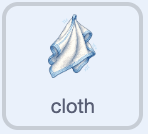

## Mettilo nello scaffale

Una volta che la ciotola è pulita, lascia che il giocatore la trascini nel supporto e totalizzi un piatto pulito.

> [!TASK]
>
> Seleziona lo sprite `cloth` nel pannello Sprite. Aggiungi uno script che indichi al giocatore cosa fare quando la ciotola è pulita.
>
> 
>
> ```blocks3
> +when I receive (clean v)
> +say [Now put it in the rack!] for (2) seconds
> ```
>
> **Verifica:** Pulisci la ciotola. Il panno dovrebbe indicare di metterlo nello scomparto.

> [!TASK]
>
> Seleziona lo sprite `cloth` nel pannello Sprite. Avvia lo script per lavare i piatti: riproduci un suono, rimuovi il sapone dal panno e rendi la ciotola trascinabile.
>
> 
>
> ```blocks3
> +when I receive (clean v)
> +start sound (Coin v)
> +set [soap v] to [false]
> +set drag mode [draggable v]
> ```
>
> **Verifica:** Pulisci la ciotola. Ora dovresti essere in grado di trascinarlo.

> [!TASK]
>
> Continua lo stesso script. Attendi che la ciotola tocchi lo sprite del "rack", quindi rimpicciolisci la ciotola in modo che sembri che sia stata riposta.
>
> 
>
> ```blocks3
> when I receive (clean v)
> start sound (Coin v)
> set [soap v] to [false]
> set drag mode [draggable v]
> +wait until <touching (rack v)?>
> +repeat (60)
> +change size by (-2)
> end
> ```
>
> **Verifica:** Pulisci la ciotola e trascinala nella griglia. Dovrebbe restringersi quando tocca il supporto.

> [!TASK]
>
> Aggiungi i blocchi per segnare la ciotola pulita, nascondila e ripristinala pronta per un altro round.
>
> 
>
> ```blocks3
> when I receive (clean v)
> start sound (Coin v)
> set [soap v] to [false]
> set drag mode [draggable v]
> wait until <touching (rack v)?>
> repeat (60)
> change size by (-2)
> end
> +change [clean plates v] by (1)
> +hide
> +set size to (0) %
> +go to x: (0) y: (-140)
> +set [clean v] to [false]
> ```
>
> **Verifica:** Metti la ciotola pulita nell'apposito scolapiatti. Dovrebbe scomparire e il punteggio `piatti puliti`{:class="block3variables"} dovrebbe aumentare.

> [!TASK]
>
> In fondo allo script, trasmetti un elemento casuale dall'elenco `stoviglie`{:class="block3variables"}. Usando la lunghezza della lista, questo blocco continuerà a funzionare dopo aver aggiunto più piatti.
>
> 
>
> ```blocks3
> when I receive (clean v)
> start sound (Coin v)
> set [soap v] to [false]
> set drag mode [draggable v]
> wait until <touching (rack v)?>
> repeat (60)
> change size by (-2)
> end
> change [clean plates v] by (1)
> hide
> set size to (0) %
> go to x: (0) y: (-140)
> set [clean v] to [false]
> +broadcast (item (pick random (1) to (length of [stuff v])) of [stuff v])
> ```

> [!TASK]
>
> Clicca sulla bandierina verde. Usa il sapone, strofina la ciotola e poi trascinala nello scolapiatti. Il punteggio dovrebbe aumentare e una nuova ciotola sporca dovrebbe salire dal lavandino.
>
> 
