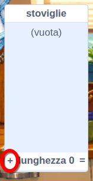
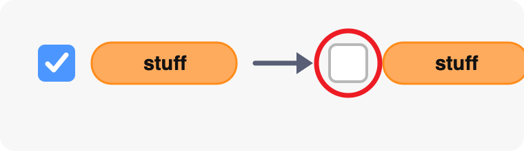
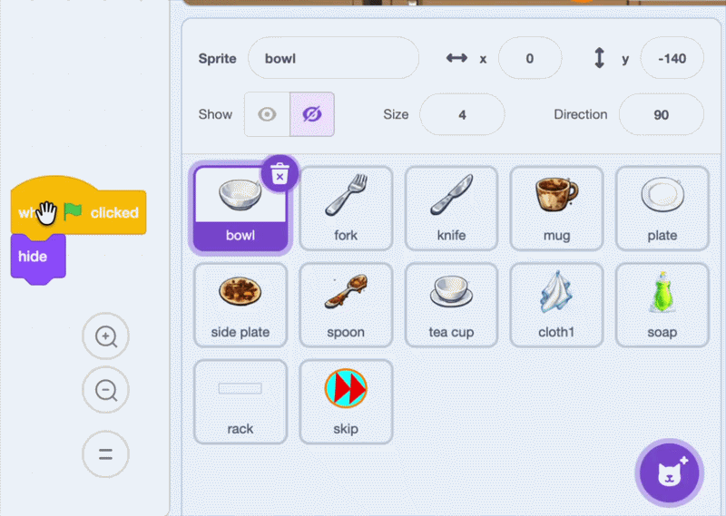

## Aggiungi gli altri piatti

Aggiungere ogni piatto alla selezione casuale, quindi copiare gli script della ciotola completati agli altri sprite del piatto.

> [!TIP]
>
> Spesso gli sviluppatori di videogiochi creano e testano prima un singolo **prototipo** funzionante. Fissare la ciotola prima di copiare i suoi script rende i problemi più facili da trovare.

> [!TASK]
>
> Apri il menu dei blocchi `Variabili`{:class="block3variables"}. Deseleziona la casella di controllo accanto a `stoviglie`{:class="block3variables"} in modo che la lista non appaia sullo Stage.
>
> 
>
> Utilizza il pulsante più (+) nell'elenco per aggiungere questi sette nomi di messaggi, uno per riga:
>
> 2. `forchetta`
> 3. `coltello`
> 4. `tazza`
> 5. `piastra`
> 6. `piastra laterale`
> 7. `cucchiaio`
> 8. `tazza da tè`
>
> 
>
> Deseleziona la casella di controllo accanto a `stoviglie`{:class="block3variables"} in modo che la lista non appaia sullo Stage.
>
> 

> [!TASK]
>
> Trascina ciascuno dei quattro script della ciotola su ogni altro sprite del piatto nel riquadro Sprite:
>
> - `forchetta`
> - `coltello`
> - `tazza`
> - `piastra`
> - `piastra laterale`
> - `cucchiaio`
> - `tazza da tè`
>
> 

> [!TASK]
>
> Seleziona lo sprite `cloth` nel pannello Sprite. Nello script che fa apparire il piatto sporco, cambia `quando ricevo (ciotola)`{:class="block3events"} con un messaggio che abbia lo stesso nome dello sprite. Scegli **Nuovo messaggio** per creare ogni messaggio la prima volta che ne hai bisogno.
>
> 
>
> Lascia il primo blocco `passa al costume ()`{:class="block3looks"} impostato sul costume numero `1`. Costume `1` è il costume sporco su ogni sprite piatto, quindi questo blocco è identico in ogni script copiato.

> [!TASK]
>
> Clicca sulla bandierina verde e gioca qualche round. Verifica che compaiano piatti sporchi diversi e che ogni piatto inizi con il costume `1`, possa essere pulito strofinando e aumenti il punteggio quando raggiunge lo scolapiatti.
>
> 

> [!TIP]
>
> La trasmissione casuale utilizza `lunghezza di [stoviglie]`{:class="block3variables"}, quindi può scegliere tra tutti gli otto elementi della lista senza che tu debba modificare l'intervallo di numeri casuali.
