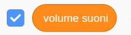
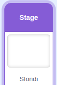
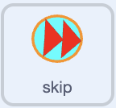
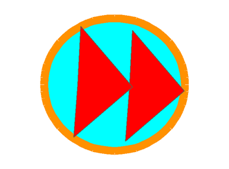

## Aggiungi controlli musicali

Aggiungi musica di sottofondo, un cursore per il volume e un pulsante per passare al brano successivo.

### Suonare

> [!TASK]
>
> Seleziona lo Stage, quindi crea queste variabili **per tutti gli sprite** dal menu dei blocchi `Variabili`{:class="block3variables"}:
>
> - `canzone`{:class="block3variables"} — questa canzone è in riproduzione. **Deseleziona questa variabile.**
> - `volume suono`{:class="block3variables"} — questo memorizza quanto forte dovrebbe essere la musica. Lascia questa variabile spuntata in modo che appaia sullo stage.
>
> <p align="center"></p>

> [!TASK]
>
> Mantieni lo Stage selezionato. Aggiungi i blocchi di configurazione musicale vicino all'inizio del suo script `Quando si clicca sulla bandierina verde`{:class="block3events"}, prima della trasmissione casuale del disegno.
>
> Nel blocco `invia a tutti ()`{:class="block3events"}, scegli **Nuovo messaggio** e crea un broadcast chiamato `puliti`.
>
> 
>
> ```blocks3
> when green flag clicked
> set [clean plates v] to (0)
> set [clean v] to [false]
> set [soap v] to [false]
> +set [song v] to (pick random (1) to (3))
> +set [music volume v] to (25)
> +broadcast (play music v)
> broadcast (item (pick random (1) to (length of [stuff v])) of [stuff v])
> ```

> [!TASK]
>
> Avvia un altro script sullo stage con un blocco `quando ricevo ()`{:class="block3events"}, e scegli il messaggio `play music`. Avvia il ciclo `per sempre`{:class="block3control"}.
>
> 
>
> ```blocks3
> +when I receive (play music v)
> +forever
> end
> ```

> [!TASK]
>
> All'inizio del ciclo `per sempre`{:class="block3control"}, controlla se il numero del brano è maggiore di `3`. Se così fosse, reimposta `canzone`{:class="block3variables"} su `1` in modo che la musica ricominci dalla prima canzone.
>
> 
>
> ```blocks3
> when I receive (play music v)
> forever
> +if <(song) > (3)> then
> +set [song v] to (1)
> end
> end
> ```

> [!TIP]
>
> Un **controllo di rollover** cerca un numero che ha superato l'ultima opzione e lo riporta all'inizio. Qui, un numero di canzone maggiore di `3` viene riportato a `1`.

> [!TASK]
>
> Sotto questo controllo, aggiungi un blocco `se () allora`{:class="block3control"}. Verifica se `canzone`{:class="block3variables"} è `1`. Per ora, lascia entrambi i rami vuoti.
>
> 
>
> ```blocks3
> when I receive (play music v)
> forever
> if <(song) > (3)> then
> set [song v] to (1)
> end
> +if <(song) = (1)> then
> else
> end
> end
> ```

> [!TASK]
>
> Nel primo ramo, aggiungi un blocco che riproduca `song1` fino al termine.
>
> 
>
> ```blocks3
> when I receive (play music v)
> forever
> if <(song) > (3)> then
> set [song v] to (1)
> end
> if <(song) = (1)> then
> +play sound (song1 v) until done
> else
> end
> end
> ```

> [!TASK]
>
> Innanzitutto, racchiudi il blocco `vai a x: y:`{:class="block3motion"} in un blocco `se () allora`{:class="block3control"}. Verifica se `canzone`{:class="block3variables"} è `2`. Per ora, lascia entrambi i rami vuoti.
>
> 
>
> ```blocks3
> when I receive (play music v)
> forever
> if <(song) > (3)> then
> set [song v] to (1)
> end
> if <(song) = (1)> then
> play sound (song1 v) until done
> else
> +if <(song) = (2)> then
> else
> end
> end
> end
> ```

> [!TASK]
>
> Nel primo ramo, aggiungi un blocco che riproduca `song1` fino al termine.
>
> 
>
> ```blocks3
> when I receive (play music v)
> forever
> if <(song) > (3)> then
> set [song v] to (1)
> end
> if <(song) = (1)> then
> play sound (song1 v) until done
> else
> if <(song) = (2)> then
> +play sound (song2 v) until done
> else
> end
> end
> end
> ```

> [!TASK]
>
> Nell'ultimo ramo `altrimenti`{:class="block3control"}, aggiungi un blocco che riproduca `song3` fino al termine.
>
> 
>
> ```blocks3
> when I receive (play music v)
> forever
> if <(song) > (3)> then
> set [song v] to (1)
> end
> if <(song) = (1)> then
> play sound (song1 v) until done
> else
> if <(song) = (2)> then
> play sound (song2 v) until done
> else
> +play sound (song3 v) until done
> end
> end
> end
> ```

> [!TASK]
>
> In fondo, all'interno del ciclo `per sempre`{:class="block3control"}, aggiungi un altro blocco `se`{:class="block3control"}. Il sistema passa automaticamente al brano successivo non appena uno termina.
>
> 
>
> ```blocks3
> when I receive (play music v)
> forever
> if <(song) > (3)> then
> set [song v] to (1)
> end
> if <(song) = (1)> then
> play sound (song1 v) until done
> else
> if <(song) = (2)> then
> play sound (song2 v) until done
> else
> play sound (song3 v) until done
> end
> end
> +change [song v] by (1)
> end
> ```

### Controlla la musica

> [!TASK]
>
> Nello Stage, fai doppio clic sulla variabile `volume suono`{:class="block3variables"} fino a quando non si trasforma in un cursore, quindi spostala nell'angolo inferiore del palco. Il lettore sarà in grado di trascinare il cursore per cambiare il volume della musica.
>
> <p align="center"></p>

> [!TASK]
>
> Mantieni lo Stage selezionato. Aggiungi un altro script in modo che il volume del suono segua il cursore `volume suono`{:class="block3variables"} mentre il gioco è in esecuzione.
>
> 
>
> ```blocks3
> +when green flag clicked
> +forever
> +set volume to (music volume) %
> end
> ```

> [!TIP]
>
> Il bilanciamento del volume della musica e degli effetti sonori si chiama **mixaggio audio**. La musica più tranquilla lascia spazio per i suoni di pulizia e punteggio.

> [!TASK]
>
> Seleziona lo sprite `cloth` nel pannello Sprite. Aggiungi uno script che impedisce al giocatore di trascinare il pulsante.
>
> 
>
> ```blocks3
> +when green flag clicked
> +set drag mode [not draggable v]
> ```

> [!TASK]
>
> Mantieni selezionato lo sprite `skip`. Aggiungi un altro script che trasmette il messaggio `skip` quando il giocatore fa clic sul pulsante sullo Stage.
>
> 
>
> ```blocks3
> +when this sprite clicked
> +broadcast (skip v)
> ```

> [!TASK]
>
> Seleziona lo Stage. Aggiungi uno script per il messaggio `skip` che interrompe il brano in riproduzione.
>
> 
>
> ```blocks3
> +when I receive (skip v)
> +stop all sounds
> ```
>
> Interrompendo il suono, la musica in loop continua fino al blocco `cambia canzone di 1`{:class="block3variables"}. Lo script di controllo del volume continua a essere eseguito e il controllo all'inizio del ciclo musicale reimposta qualsiasi numero di brano maggiore di `3`.

> [!TASK]
>
> Clicca sulla bandierina verde e gioca qualche round. Trascina il cursore del volume e verifica se la musica diventa più bassa o più alta. Fai clic sul pulsante salta nella schermata e verifica che la canzone cambi.
>
> <p align="center"></p>

> [!SAVE]
