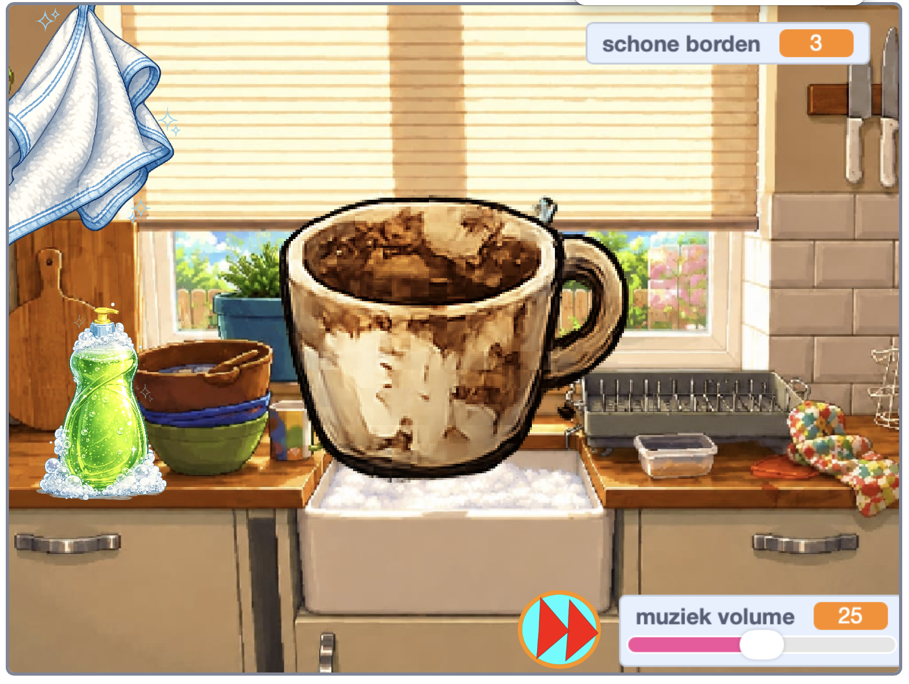

## Wat ga je maken

Je gaat een **afwassimulator** bouwen. De speler voegt zeep toe, schrobt een vuile vaat tot deze glanst, en sleept deze vervolgens naar het afdruiprek voordat de volgende vuile vaat verschijnt.

