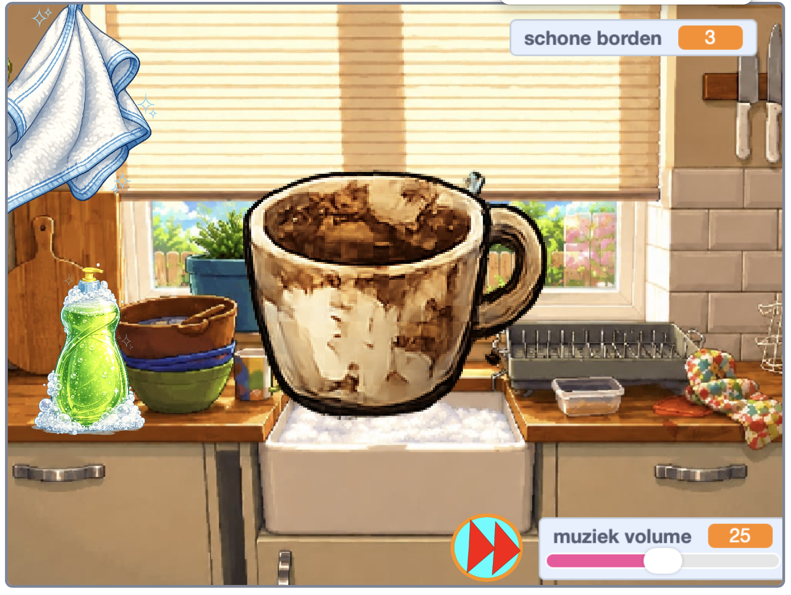

## Wat ga je maken

Je gaat een **gezellige afwassimulator** bouwen. De speler voegt zeep toe, schrobt een vuile vaat tot deze glanst, en sleept deze vervolgens naar het afdruiprek voordat de volgende vuile vaat verschijnt.

> [!TIP]
>
> Een **gezellig spel** is ontworpen om een kalm, uitnodigend en bevredigend gevoel te geven, in plaats van stressvol of competitief.

> [!NOPRINT]
>
> 

>  <iframe allowtransparency="true" width="485" height="402" src="https://scratch.mit.edu/projects/embed/1362381726/?autostart=false" frameborder="0"></iframe>
> 

> [!PRINTONLY]
>
> 

Je begint met een Scratch-project dat al sprites, uiterlijken en geluiden heeft. Je maakt variabelen en een lijst terwijl je de code bouwt.

### Je hebt nodig:

- De Scratch-editor
- Het [Afwassimulator start project](https://scratch.mit.edu/projects/1362382639/editor){:target="_blank"} project
