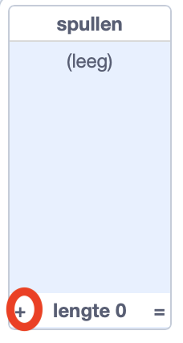
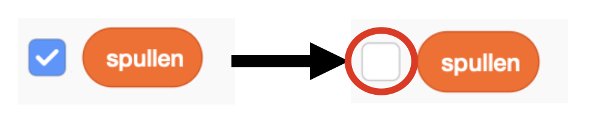
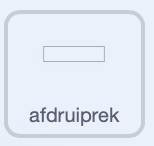
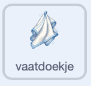
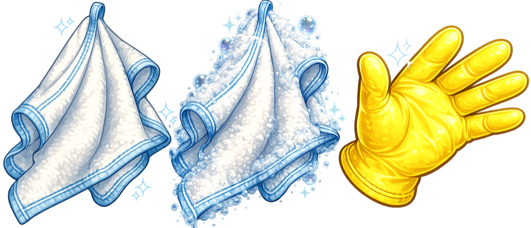

## Begin met afwassen

Stel de spelstatus in, plaats het rek en zorg ervoor dat het vaatdoekje de muisaanwijzer volgt.

> [!TASK]
>
> Open het [Afwassimulator start project](https://scratch.mit.edu/projects/1362382639/editor){:target="_blank"} project. Het bevat al de sprites, uiterlijken en geluiden die je nodig hebt.

> [!TASK]
>
> Open het menu met `Variabelen`{:class="block3variables"} blokken. Maak deze variabelen **voor alle sprites**:
>
> - `schone borden`{:class="block3variables"} — hierin wordt de score van de speler opgeslagen. Laat deze variabele aangevinkt staan zodat deze op het speelveld verschijnt.
> - `schoon`{:class="block3variables"} — hierin wordt een Booleaanse waarde opgeslagen die aangeeft of de huidige vaat schoon is. **Schakel deze variabele uit.**
> - `zeep`{:class="block3variables"} — hierin wordt een Booleaanse waarde opgeslagen die aangeeft of de speler zeep heeft gepakt. **Schakel deze variabele uit.**
>
> Zorg ervoor dat alleen de variabele `schone borden` nog aangevinkt is:
>
> <p align="center"></p>

> [!TASK]
>
> Houd het speelveld geselecteerd. Kies **Maak een lijst** uit het `Variabelen`{:class="block3variables"} blokken menu en maak een lijst met de naam `spullen`{:class="block3variables"} **voor alle sprites**.
>
> Voeg `kom` toe als eerste item in de lijst. Je voegt de andere vaat later toe.
>
> 
>
> Schakel het selectievakje naast `spullen`{:class="block3variables"} uit, zodat de lijst niet op het Speelveld-scherm verschijnt.
>
> 

> [!TASK]
>
> Voeg onderstaand script toe aan het speelveld om het spel te resetten. In dit project slaan de variabelen `schoon` en `zeep` alleen de waarden `waar` of `niet waar` op, dus initialiseer ze beide met de Booleaanse waarde `niet waar`.
>
> Kies in het menu in het `zend signaal()`{:class="block3events"} blok, **Nieuw bericht**. Noem het nieuwe bericht `kom`.
>
> 
>
> ```blocks3
> +when green flag clicked
> +set [clean plates v] to (0)
> +set [clean v] to [false]
> +set [soap v] to [false]
> +broadcast (bowl v)
> ```

> [!TIP]
>
> Een variabele **initialiseren** betekent dat je er een beginwaarde aan geeft. Hier begint het spel met een score van `0`, en `schoon` en `zeep` zijn ingesteld op `niet waar`.

> [!TASK]
>
> Vervang `kom` in het `zend signaal ()`{:class="block3events"} blok door blokken die een willekeurig item selecteren uit `spullen`{:class="block3variables"}.
>
> Er staat momenteel maar één item in de lijst, dus dit script zal altijd `kom` uitzenden. Als je later meer items toevoegt, zal code zelf iets kiezen.
>
> 
>
> ```blocks3
> when green flag clicked
> set [clean plates v] to (0)
> set [clean v] to [false]
> set [soap v] to [false]
> +broadcast (item (pick random (1) to (length of [stuff v])) of [stuff v])
> ```

> [!TASK]
>
> Selecteer de 'rek'-sprite in het Sprite-venster. Het zal het plek zijn voor de schone afwas. Gebruik een `wanneer op groene vlag wordt geklikt`{:class="block3events"} blok om het op de juiste plaats te zetten.
>
> De 'rek' sprite is slechts een botsingsvak. Het ziet er eenvoudig uit omdat het afdruiprek dat de speler ziet al op de achtergrond is getekend.
>
> 
>
> ```blocks3
> +when green flag clicked
> +go to x: (140) y: (-38)
> ```

> [!TIP]
>
> In games **botsen** twee sprites tegen elkaar wanneer ze elkaar raken. Later zal een `raak ik ()?`{:class="block3sensing"} blok detecteren wanneer een schoon bord tegen het rek botst.

> [!TASK]
>
> Selecteer de `vaatdoek` sprite in het Sprite-venster. Voeg dit script toe zodat de vaatdoek de muisaanwijzer volgt en voor de andere sprites blijft.
>
> 
>
> ```blocks3
> +when green flag clicked
> +forever
> +go to (mouse-pointer v)
> +go to [front v] layer
> end
> ```

> [!TASK]
>
> <p align="center"></p>
>
> Klik op de groene vlag en beweeg dan de muisaanwijzer over het speelveld. Het vaatdoekje zou de muisaanwijzer moeten volgen.
