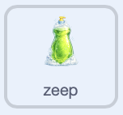
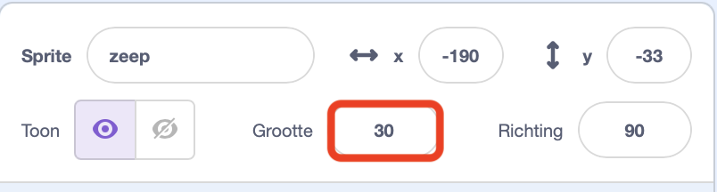

## Voeg zeep en een vaatdoek toe

Maak de zeep klikbaar en laat het vaatdoekje veranderen om de spelstatus weer te geven.

> [!TASK]
>
> Selecteer de `zeep` sprite in het Sprite-venster. Voeg code toe zodat de speler de zeep kan gebruiken voordat hij de afwas doet.
>
> 
>
> ```blocks3
> +when this sprite clicked
> +start sound (Bubbles v)
> +set [soap v] to [true]
> ```

> [!TASK]
>
> Voeg nog een script toe aan de `zeep`-sprite zodat deze achter de afwas komt te staan.
>
> 
>
> ```blocks3
> +when green flag clicked
> +set drag mode [not draggable v]
> +go to [back v] layer
> ```

> [!NOTE]
>
> `zet sleepbaar op [niet sleepbaar]` voorkomt alleen slepen in volledig scherm modus. Tijdens het testen in de editor kun je de zeep en andere sprites nog steeds verslepen.

> [!TASK]
>
> Start nog een script op de `zeep`-sprite. Stel de grootte in op 30 procent voordat je blokken toevoegt die de grootte ervan wijzigen. Dankzij deze bekende startgrootte is het eenvoudig om de zeep opnieuw in te stellen als je een fout maakt.
>
> Voeg een `herhaal`{:class="block3control"} lus toe onder het maak grootte-blok.
>
> 
>
> ```blocks3
> +when green flag clicked
> +set size to (30) %
> +forever
> end
> ```

> [!TIP]
>
> 30 procent is de vooraf ingestelde startgrootte voor de zeep. Je kunt experimenteren door de waarde in het `maak grootte () %`{:class="block3looks"} blok te wijzigen en deze terug te zetten naar `30` als je de grootte wilt resetten.
>
> 

> [!TASK]
>
> Voeg binnen de `herhaal`{:class="block3control"} lus een `herhaal ()`{:class="block3control"} lus toe die de zeep geleidelijk groter maakt.
>
> 
>
> ```blocks3
> when green flag clicked
> set size to (30) %
> forever
> +repeat (15)
> +change size by (0.2)
> end
> end
> ```

> [!TIP]
>
> Om tijd te besparen, klik je met de rechtermuisknop op het bovenste blok in een groep en kies **Dupliceren** om de hele groep te kopiëren. Probeer dit eens met de blokken `herhaal ()` en `verander grootte met ()`, of met een `als () dan anders`-blok dat al een operator en variabele bevat. Verander dan alleen de dingen die je moet aanpassen.

> [!TASK]
>
> Voeg onder de eerste `herhaal ()`{:class="block3control"} lus een andere lus toe die de zeep terugzet naar `30` procent.
>
> Samen laten de twee lussen de zeep zachtjes groeien en krimpen. Dit trekt de aandacht van de speler en maakt het duidelijk dat ze iets met de zeep kunnen doen.
>
> 
>
> ```blocks3
> when green flag clicked
> set size to (30) %
> forever
> repeat (15)
> change size by (0.2)
> end
> +repeat (15)
> +change size by (-0.2)
> end
> end
> ```

> [!TASK]
>
> Selecteer de `vaatdoek` sprite in het Sprite-venster. Voeg een ander script toe dat begint met het tonen van de droge vaatdoek.
>
> 
>
> ```blocks3
> +when green flag clicked
> +forever
> +switch costume to (cloth1 v)
> end
> ```

> [!TASK]
>
> Vervang het `verander uiterlijk naar (cloth1 v)`{:class="block3looks"} blok door een `als () dan anders`{:class="block3control"} blok. Bewaar de droge doek in de `anders`{:class="block3control"} tak.
>
> 
>
> ```blocks3
> when green flag clicked
> forever
> +if <(clean) = [true]> then
> else
> switch costume to (cloth1 v)
> end
> end
> ```

> [!TASK]
>
> Voeg een `verander uiterlijk naar ()`{:class="block3looks"} blok toe binnen de eerste tak om de hand te tonen wanneer de vaat schoon is.
>
> 
>
> ```blocks3
> when green flag clicked
> forever
> if <(clean) = [true]> then
> +switch costume to (hand v)
> else
> switch costume to (cloth1 v)
> end
> end
> ```

> [!TASK]
>
> Voeg binnen het `anders`-blok nog een `als () dan anders`-blok toe om te controleren of de speler zeep heeft gepakt. Bewaar de droge doek in de nieuwe `anders`{:class="block3control"} tak.
>
> 
>
> ```blocks3
> when green flag clicked
> forever
> if <(clean) = [true]> then
> switch costume to (hand v)
> else
> +if <(soap) = [true]> then
> else
> switch costume to (cloth1 v)
> end
> end
> end
> ```

> [!TASK]
>
> Voeg een `verander uiterlijk naar ()`{:class="block3looks"} blok toe in de zeep tak om de ingezeepte vaatdoek te tonen.
>
> 
>
> ```blocks3
> when green flag clicked
> forever
> if <(clean) = [true]> then
> switch costume to (hand v)
> else
> if <(soap) = [true]> then
> +switch costume to (cloth2 v)
> else
> switch costume to (cloth1 v)
> end
> end
> end
> ```

> [!TASK]
>
> <p align="center"></p>
>
> Klik op de groene vlag en klik vervolgens op de zeep in het speelveld. De zeep moet zachtjes pulseren, waarna het vaatdoekje verandert in een ingezeept uiterlijk.

> [!TIP]
>
> **Visuele feedback** laat de speler zien dat een actie is gelukt. Door het uiterlijk van het doekje te veranderen, laat je zien dat de speler zeep heeft gepakt.
