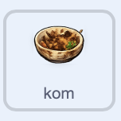

## Laat de vaat verschijnen

Programmeer de `kom` eerst. Later zul je het script naar de andere vaat sprites kopiëren.

In het startproject heet deze sprite `kom` en zijn uiterlijken `1` tot `6`. Het uiterlijk `1` is de vuile kom en het uiterlijk `6` is de helemaal schone kom.


> [!TASK]
>
> Selecteer de `kom` sprite in het Sprite-venster. Voeg een `wanneer op groene vlag wordt geklikt`{:class="block3events"} blok toe met een `verdwijn`{:class="block3looks"} blok.
>
> 
>
> ```blocks3
> +when green flag clicked
> +hide
> ```

> [!TASK]
>
> Start een ander script op de `kom` sprite met een `wanneer ik signaal ontvang ()`{:class="block3events"} blok ontvang. Kies het `kom` bericht dat je eerder hebt gemaakt.
>
> Verander de sprite naar kostuum nummer `1` zodat de vuile kom in de gootsteen verschijnt.
>
> 
>
> ```blocks3
> +when I receive (bowl v)
> +switch costume to (1)
> +set [clean v] to [false]
> +set size to (0) %
> +go to x: (0) y: (-120)
> +show
> +set drag mode [not draggable v]
> ```

> [!TASK]
>
> Voeg een lus toe aan hetzelfde script om de kom uit de gootsteen te laten omhoogkomen.
>
> 
>
> ```blocks3
> when I receive (bowl v)
> switch costume to (1)
> set [clean v] to [false]
> set size to (0) %
> go to x: (0) y: (-120)
> show
> set drag mode [not draggable v]
> +repeat (20)
> +change y by (6)
> +change size by (6)
> end
> ```

> [!TASK]
>
> Voeg onderaan hetzelfde script blokken toe om te wachten tot de kom schoon is. Kies in het `zend signaal ()`{:class="block3events"} blok **Nieuw bericht** en maak een signaal met de naam `schoon`.
>
> 
>
> ```blocks3
> when I receive (bowl v)
> switch costume to (1)
> set [clean v] to [false]
> set size to (0) %
> go to x: (0) y: (-120)
> show
> set drag mode [not draggable v]
> repeat (20)
> change y by (6)
> change size by (6)
> end
> +wait until <(clean) = [true]>
> +broadcast (clean v)
> ```

> [!TASK]
>
> 
>
> Klik op de groene vlag. De vuile kom moet in het midden van de gootsteen verschijnen.

> [!TIP]
>
> De kom begint klein en groeit naarmate hij uit gootsteen omhoogkomt.
