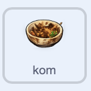

## Doe de afwas

Laat de speler zeep toevoegen en vervolgens door de vuile kostuums heen de kom schrobben.

> [!TASK]
>
> Selecteer de sprite 'kom' in het spritevenster en selecteer vervolgens het tabblad **Uiterlijken**. Controleer of de zes uiterlijken de nummers '1' tot en met '6' hebben: kostuum '1' is vies en kostuum '6' is brandschoon.
>
> 

> [!TASK]
>
> Selecteer het tabblad **Code** voor de `kom` sprite. Start een script dat reageert wanneer de speler op de kom op het speelveld klikt, maar alleen zolang deze nog schoongemaakt moet worden.
>
> 
>
> ```blocks3
> +when this sprite clicked
> +if <(clean) = [false]> then
> end
> ```

> [!TASK]
>
> Voeg binnen het `als () dan`{:class="block3control"} blok een `als () dan anders`{:class="block3control"} blok toe. Controleer of de speler zeep heeft gepakt. Laat beide takken voorlopig leeg.
>
> 
>
> ```blocks3
> when this sprite clicked
> if <(clean) = [false]> then
> +if <(soap) = [true]> then
> else
> end
> end
> ```

> [!TASK]
>
> Voeg in de zeep-tak een `herhaal tot ()`{:class="block3control"} lus toe. Laat het stoppen wanneer de kom uiterlijk nummer '6' bereikt.
>
> 
>
> ```blocks3
> when this sprite clicked
> if <(clean) = [false]> then
> if <(soap) = [true]> then
> +repeat until <(costume [number v]) = (6)>
> end
> else
> end
> end
> ```

> [!TASK]
>
> Wacht binnen de nieuwe lus totdat de speler de muisknop indrukt.
>
> 
>
> ```blocks3
> when this sprite clicked
> if <(clean) = [false]> then
> if <(soap) = [true]> then
> repeat until <(costume [number v]) = (6)>
> +wait until <mouse down?>
> end
> else
> end
> end
> ```

> [!TASK]
>
> Speel onder het `wacht tot ()`{:class="block3control"} blok een willekeurig schoonmaakgeluid af, ga naar het volgende uiterlijk en voeg een korte vertraging toe.
>
> 
>
> ```blocks3
> when this sprite clicked
> if <(clean) = [false]> then
> if <(soap) = [true]> then
> repeat until <(costume [number v]) = (6)>
> wait until <mouse down?>
> +start sound (pick random (1) to (4))
> +next costume
> +wait (0.2) seconds
> end
> else
> end
> end
> ```

> [!TASK]
>
> Na de `herhaal tot ()`{:class="block3control"} lus, stel `schoon`{:class="block3variables"} in op `waar`. Dit laat de andere scripts weten dat het schoonmaken klaar is.
>
> 
>
> ```blocks3
> when this sprite clicked
> if <(clean) = [false]> then
> if <(soap) = [true]> then
> repeat until <(costume [number v]) = (6)>
> wait until <mouse down?>
> start sound (pick random (1) to (4))
> next costume
> wait (0.2) seconds
> end
> +set [clean v] to [true]
> else
> end
> end
> ```

> [!TASK]
>
> Voeg tot slot feedback toe aan de `anders`{:class="block3control"} tak voor een speler die de kom probeert schoon te maken zonder zeep.
>
> 
>
> ```blocks3
> when this sprite clicked
> if <(clean) = [false]> then
> if <(soap) = [true]> then
> repeat until <(costume [number v]) = (6)>
> wait until <mouse down?>
> start sound (pick random (1) to (4))
> next costume
> wait (0.2) seconds
> end
> set [clean v] to [true]
> else
> +say [You need soap!] for (2) seconds
> +start sound (Collect v)
> end
> end
> ```

> [!TASK]
>
> Klik op de groene vlag en klik vervolgens op de kom voordat je de zeep gebruikt. Klik vervolgens op de zeep en klik en houd de kom ingedrukt om hem schoon te schrobben.
>
>  

> [!TIP]
>
> Voordat de speler zeep gebruikt, geeft de kom aan wat hij nodig heeft. Nadat de speler zeep heeft gebruikt, doorloopt de `herhaal to`-lus de uiterlijken en stopt bij uiterlijk `6`, de brandschone kom.
