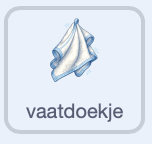
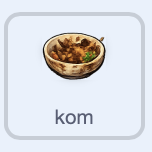

## Plaats het in het afdruiprek

Zodra de kom schoon is, laat de speler deze op het rek zetten en een schoon bord scoren.

> [!TASK]
>
> Selecteer de `vaatdoek` sprite in het Sprite-venster. Voeg een script toe dat de speler vertelt wat hij moet doen als de kom schoon is.
>
> 
>
> ```blocks3
> +when I receive (clean v)
> +say [Now put it in the rack!] for (2) seconds
> ```
>
> **Controleer:** Maak de kom schoon. Het vaatdoekje zou je moeten vertellen om hem op het afdruiprek te zetten.

> [!TASK]
>
> Selecteer de `kom` sprite in het Sprite-venster. Start het script voor het afwassen: speel een geluid af, verwijder de zeep van de vaatdoek en maak de kom verplaatsbaar.
>
> 
>
> ```blocks3
> +when I receive (clean v)
> +start sound (Coin v)
> +set [soap v] to [false]
> +set drag mode [draggable v]
> ```
>
> **Controleer:** Was de kom nog een keer af. Je zou hem nu moeten kunnen slepen.

> [!TASK]
>
> Ga verder met hetzelfde script. Wacht totdat de kom de 'rek' sprite aanraakt, en verklein daarna de kom zodat het lijkt hij is weggezet.
>
> 
>
> ```blocks3
> when I receive (clean v)
> start sound (Coin v)
> set [soap v] to [false]
> set drag mode [draggable v]
> +wait until <touching (rack v)?>
> +repeat (60)
> +change size by (-2)
> end
> ```
>
> **Controleer:** Maak de kom schoon en sleep hem naar het afdruiprek. Hij moet kleiner worden wanneer hij het rek raakt.

> [!TASK]
>
> Voeg blokken toe om score toe te kennen voor de schone kom, verberg hem en zet hem klaar voor een volgende ronde.
>
> 
>
> ```blocks3
> when I receive (clean v)
> start sound (Coin v)
> set [soap v] to [false]
> set drag mode [draggable v]
> wait until <touching (rack v)?>
> repeat (60)
> change size by (-2)
> end
> +change [clean plates v] by (1)
> +hide
> +set size to (0) %
> +go to x: (0) y: (-140)
> +set [clean v] to [false]
> ```
>
> **Controleer:** Plaats de schone kom in het afdruiprek. Hij zou moeten verdwijnen en de score voor `schone borden` zou moeten stijgen.

> [!TASK]
>
> Onderaan het script moet een willekeurig item uit de lijst `spullen`{:class="block3variables"} worden verzonden. Door de lengte van de lijst te gebruiken, blijft dit codeblok werken, zelfs nadat je meer afwas hebt toegevoegd.
>
> 
>
> ```blocks3
> when I receive (clean v)
> start sound (Coin v)
> set [soap v] to [false]
> set drag mode [draggable v]
> wait until <touching (rack v)?>
> repeat (60)
> change size by (-2)
> end
> change [clean plates v] by (1)
> hide
> set size to (0) %
> go to x: (0) y: (-140)
> set [clean v] to [false]
> +broadcast (item (pick random (1) to (length of [stuff v])) of [stuff v])
> ```

> [!TASK]
>
> Klik op de groene vlag. Gebruik de zeep om de kom goed af te wassen en zet hem vervolgens in het afdruiprek. De score zou moeten stijgen en er zou een nieuwe vuile kom uit de gootsteen omhoog moeten komen.
>
> 
