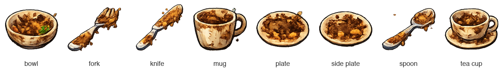
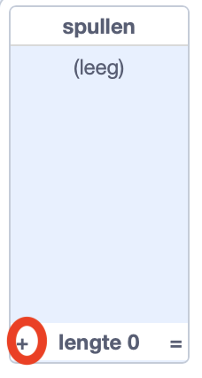
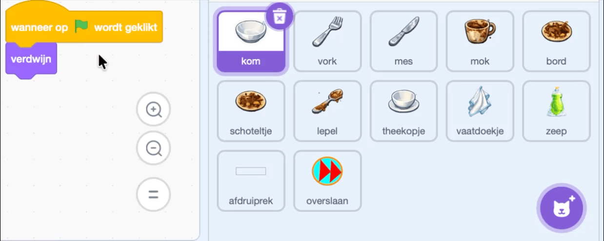

## Voeg de andere vaat toe

Voeg alle vaat toe aan de willekeurige selectie en kopieer vervolgens de voltooide kom scripts naar de andere vaat sprites.

> [!TIP]
>
> Spelontwikkelaars bouwen en testen vaak eerst een werkend **prototype**. Het verbeteren van fouten in de kom voordat je de scripts kopieert zorgt er voor dat je problemen makkelijker opspoort.

> [!TASK]
>
> Selecteer het speelveld en open het `Variabelen`{:class="block3variables"} blokken menu. Schakel het selectievakje naast `spullen`{:class="block3variables"} in, zodat de lijst op het Speelveld-scherm verschijnt.
>
> 
>
> Gebruik de plusknop in de lijst om deze zeven berichtnamen toe te voegen, een item op elke regel:
>
> 2. `vork`
> 3. `mes`
> 4. `mok`
> 5. `bord`
> 6. `schoteltje`
> 7. `lepel`
> 8. `theekopje`
>
> 
>
> Schakel het selectievakje naast `spullen`{:class="block3variables"} weer uit, zodat de lijst niet op het Speelveld-scherm verschijnt.
>
> 

> [!TASK]
>
> Sleep elk van de vier scripts van de kom naar elke andere vaat-sprite in het spritevenster:
>
> - `vork`
> - `mes`
> - `mok`
> - `bord`
> - `schoteltje`
> - `lepel`
> - `theekopje`
>
> 

> [!TASK]
>
> Selecteer elke gekopieerde sprite in het Sprite-paneel. In het script dat de vuile schaal laat verschijnen, wijzig je `wanneer ik (kom) ontvang`{:class="block3events"} in een bericht met dezelfde naam als de sprite. Kies **Nieuw bericht** om elk bericht te maken.
>
> 
>
> Laat het eerste `verander uiterlijk naar ()`{:class="block3looks"} blok ingesteld op uiterlijk nummer `1`. Het uiterlijk `1` is het vieze uiterlijk van elke sprite, dus dit blok is identiek in elk gekopieerd script.

> [!TASK]
>
> Klik op de groene vlag en speel een aantal rondes. Controleer of er verschillende soorten vuile vaat verschijnt en of elke vaat begint met uiterlijk '1', kan worden afgewassen en de score verhoogt wanneer deze op het rekje wordt gezet.
>
> 

> [!TIP]
>
> Het willekeurige signaal gebruikt `lengte van [spullen]`{:class="block3variables"}, zodat het uit alle acht lijstitems kan kiezen zonder dat je het willekeurige bereik wijzigt.
