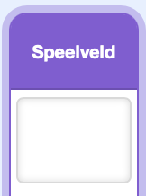
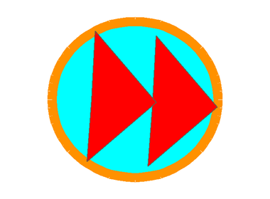

## Muziek besturing toevoegen

Voeg achtergrondmuziek, een volumeregelaar en een knop toe om naar het volgende nummer te gaan.

### Speel muziek af

> [!TASK]
>
> Selecteer het speelveld en maak deze variabelen **voor alle sprites** aan uit het `Variabelen`{:class="block3variables"} blokken menu:
>
> - `liedje`{:class="block3variables"} — hierin wordt opgeslagen welk nummer er wordt afgespeeld. **Schakel deze variabele uit.**
> - `volume`{:class="block3variables"} — hierin wordt opgeslagen hoe hard de muziek moet zijn. Laat deze variabele aangevinkt staan zodat deze op het speelveld verschijnt.
>
> <p align="center"></p>

> [!TASK]
>
> Houd het speelveld geselecteerd. Voeg de muziek instellingen-blokken toe bij het begin van het `wanneer op groene vlag wordt geklikt`{:class="block3events"} script, voordat het willekeurige signaal voor de vaat wordt verzonden.
>
> Kies in het `zend signaal ()`{:class="block3events"} blok **Nieuw bericht** en maak een bericht met de naam `muziek afspelen`.
>
> 
>
> ```blocks3
> when green flag clicked
> set [clean plates v] to (0)
> set [clean v] to [false]
> set [soap v] to [false]
> +set [song v] to (pick random (1) to (3))
> +set [music volume v] to (25)
> +broadcast (play music v)
> broadcast (item (pick random (1) to (length of [stuff v])) of [stuff v])
> ```

> [!TASK]
>
> Start een ander script op het speelveld met een `wanneer ik signaal () ontvang`{:class="block3events"} blok en kies het bericht `muziek afspelen `. Voeg een lege `herhaal`{:class="block3control"} lus toe.
>
> 
>
> ```blocks3
> +when I receive (play music v)
> +forever
> end
> ```

> [!TASK]
>
> Controleer bovenaan de `herhaal`{:class="block3control"} lus, of het nummer van het liedje groter is dan `3`. Als dat het geval is, zet dan `liedje`{:class="block3variables"} terug naar `1` zodat de muziek weer vanaf het eerste nummer begint.
>
> 
>
> ```blocks3
> when I receive (play music v)
> forever
> +if <(song) > (3)> then
> +set [song v] to (1)
> end
> end
> ```

> [!TIP]
>
> Een **rollover check** zoekt naar een getal dat de laatste optie overschrijdt en stuurt het terug naar het begin. Hier wordt een liednummer groter dan `3` omgezet naar `1`.

> [!TASK]
>
> Voeg onder die controle een `als () dan anders`{:class="block3control"} blok toe. Controleer of `liedje `{:class="block3variables"} gelijk is aan `1`. Laat beide takken voorlopig leeg.
>
> 
>
> ```blocks3
> when I receive (play music v)
> forever
> if <(song) > (3)> then
> set [song v] to (1)
> end
> +if <(song) = (1)> then
> else
> end
> end
> ```

> [!TASK]
>
> Voeg in de eerste tak een blok toe dat `liedje1` afspeelt totdat het is afgelopen.
>
> 
>
> ```blocks3
> when I receive (play music v)
> forever
> if <(song) > (3)> then
> set [song v] to (1)
> end
> if <(song) = (1)> then
> +play sound (song1 v) until done
> else
> end
> end
> ```

> [!TASK]
>
> Voeg binnen de eerste `anders`{:class="block3control"} tak nog een `als () dan anders`{:class="block3control"} blok toe. Controleer of `liedje `{:class="block3variables"} gelijk is aan `2`. Laat beide nieuwe takken voorlopig leeg.
>
> 
>
> ```blocks3
> when I receive (play music v)
> forever
> if <(song) > (3)> then
> set [song v] to (1)
> end
> if <(song) = (1)> then
> play sound (song1 v) until done
> else
> +if <(song) = (2)> then
> else
> end
> end
> end
> ```

> [!TASK]
>
> Voeg in de `liedje = 2`-tak een blok toe dat `liedje2` afspeelt totdat het is afgelopen.
>
> 
>
> ```blocks3
> when I receive (play music v)
> forever
> if <(song) > (3)> then
> set [song v] to (1)
> end
> if <(song) = (1)> then
> play sound (song1 v) until done
> else
> if <(song) = (2)> then
> +play sound (song2 v) until done
> else
> end
> end
> end
> ```

> [!TASK]
>
> Voeg in de laatste `anders`{:class="block3control"} tak een blok toe dat `liedje3` afspeelt totdat het is afgelopen.
>
> 
>
> ```blocks3
> when I receive (play music v)
> forever
> if <(song) > (3)> then
> set [song v] to (1)
> end
> if <(song) = (1)> then
> play sound (song1 v) until done
> else
> if <(song) = (2)> then
> play sound (song2 v) until done
> else
> +play sound (song3 v) until done
> end
> end
> end
> ```

> [!TASK]
>
> Voeg onderaan het `herhaal`{:class="block3control"} blok een `verander () met ()`{:class="block3variables"} blok toe. Zo wordt zodra een nummer is afgelopen, het volgende nummer automatisch afgespeeld.
>
> 
>
> ```blocks3
> when I receive (play music v)
> forever
> if <(song) > (3)> then
> set [song v] to (1)
> end
> if <(song) = (1)> then
> play sound (song1 v) until done
> else
> if <(song) = (2)> then
> play sound (song2 v) until done
> else
> play sound (song3 v) until done
> end
> end
> +change [song v] by (1)
> end
> ```

### Regel de muziek

> [!TASK]
>
> Op het speelveld, dubbelklik op de weergave van de variabele `volume` totdat deze verandert in een schuifregelaar, en verplaats deze vervolgens naar de onderste hoek van het speelveld. De speler kan de schuifregelaar gebruiken om het muziekvolume aan te passen.
>
> <p align="center"></p>

> [!TASK]
>
> Houd het speelveld geselecteerd. Voeg nog een script toe zodat het geluidsvolume de `muziek volume`{:class="block3variables"} schuifregelaar volgt tijdens het spelen.
>
> 
>
> ```blocks3
> +when green flag clicked
> +forever
> +set volume to (music volume) %
> end
> ```

> [!TIP]
>
> Het op elkaar afstemmen van het volume van de muziek en de geluidseffecten wordt **audiomixing** genoemd. Rustigere muziek zorgt ervoor dat je de schoonmaak- en score geluiden nog kan horen.

> [!TASK]
>
> Selecteer de `overslaan`-sprite in het Sprite-paneel. Voeg een script toe dat voorkomt dat de speler de knop kan verslepen.
>
> 
>
> ```blocks3
> +when green flag clicked
> +set drag mode [not draggable v]
> ```

> [!TASK]
>
> Houd de `overslaan`-sprite geselecteerd. Voeg een extra script toe dat het bericht 'overslaan' uitzendt wanneer de speler op de knop op het podium klikt.
>
> 
>
> ```blocks3
> +when this sprite clicked
> +broadcast (skip v)
> ```

> [!TASK]
>
> Selecteer het Speelveld. Voeg een script toe voor het `overslaan`-bericht dat het huidige nummer stopt.
>
> 
>
> ```blocks3
> +when I receive (skip v)
> +stop all sounds
> ```
>
> Door het geluid te stoppen, kan de muziekloop verdergaan naar het `verander liedje met 1`{:class="block3variables"} blok. Het script voor volumeregeling blijft draaien en de controle aan het begin van de muziekloop reset elk nummer dat groter is dan `3`.

> [!TASK]
>
> Klik op de groene vlag en doe de afwas. Verschuif de volumeschuifregelaar en controleer of de muziek zachter of harder wordt. Klik op de overslaan knop in het speelveld en controleer of het nummer verandert.
>
> <p align="center"></p>

> [!SAVE]
